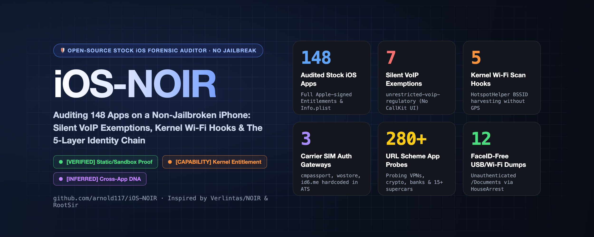

<p align="center">
  
</p>

# iOS-NOIR

**English · [简体中文](README.zh-CN.md)**

[](LICENSE)
[-blue.svg)](#)
[](#)

**Turn "What is my iPhone silently leaking?" into a reproducible, evidence-graded forensic report — without jailbreaking.**  
**把「这台未越狱的 iPhone 到底在暗中泄露什么」变成一份带三级证据标注的可复现底层取证报告。**

📊 **Sample Standalone Interactive Report (7-Tab HTML):** [`report/ios-noir-sample-report.html`](report/ios-noir-sample-report.html) *(Download & open directly in any browser)*

> 💡 **Acknowledgements / 致敬**  
> - **Architecture & CLI Flow:** Inspired by [**Verlintas/NOIR**](https://github.com/Verlintas/NOIR) (the local-first Android privacy auditor over `adb`).  
> - **Evidence Tiering, 5-Layer Persistent Identity Chain & Standalone HTML Report:** Inspired by [**RootSir/claude-ios-privacy-analysis**](https://github.com/RootSir/claude-ios-privacy-analysis).

---

## ⚖️ Three-Tier Evidence Grading (证据分级标准)

Following the forensic rigor of [`RootSir/claude-ios-privacy-analysis`](https://github.com/RootSir/claude-ios-privacy-analysis), **iOS-NOIR** explicitly distinguishes between static configuration evidence, kernel capability entitlements, and behavioral inference:

- 🟢 **`【实锤 / VERIFIED】`**: Directly extracted from Apple-signed `Entitlements`, `Info.plist` static whitelists (`LSApplicationQueriesSchemes`, `NSExceptionDomains`), `ubiquity-kvstore-identifier`, or live `HouseArrest` sandbox filesystem enumeration.
- 🟠 **`【机制实锤 / CAPABILITY】`**: The app holds an Apple-signed privileged entitlement (`unrestricted-voip-regulatory`, `HotspotHelper`, `multipath`, `network-authentication`) granting kernel-level bypass capabilities; actual trigger frequency depends on server push/runtime state.
- 🟣 **`【推断 / INFERRED】`**: Cross-app identity correlation inferred from shared `App Groups` (`group.*`), shared `Keychain Access Groups`, and embedded risk/attribution SDK endpoints (`shuzilm.cn`, `id6.me`, `miaozhen.com`).

---

## 🔍 Core Findings & The 5-Layer Persistent Identity Chain

Why does turning off `Allow Apps to Request to Track (IDFA)`, connecting to a VPN, and reinstalling an app still fail to prevent cross-app device tracking on stock iOS? **iOS-NOIR** audits 10+ blind spots and maps the **5-Layer Persistent Device Identity Chain**:

### 🧬 5-Layer Persistent Identity & VPN-Bypass Chain
1. **Layer 1 — Uninstall- & New-iPhone-Proof iCloud KVS (`ubiquity-kvstore-identifier`)** `【实锤】`: Writes tracking tokens into your private iCloud key-value store that automatically restore even after app uninstallation or migrating to a brand-new iPhone.
2. **Layer 2 — Uninstall-Proof Shared Keychain (`keychain-access-groups`)** `【实锤】`: iOS Keychain items persist across app uninstalls and are shared across apps signed by the same developer Team ID.
3. **Layer 3 — Cross-App Collusion Pools (`com.apple.security.application-groups`)** `【实锤】`: Shared local storage containers (`group.*`) survive uninstallation as long as *any single sister app* from the same corporate family remains installed.
4. **Layer 4 — Cellular Gateway VPN Bypass (`multipath` & `network-authentication`)** `【机制实锤】`: Allows apps to force cellular interface (`pdp_ip0`) connections to telecom gateways (`cmpassport.com`, `wostore.cn`, `id6.me`) for silent SIM/phone-number (`MDN`) extraction even while on Wi-Fi or VPN.
5. **Layer 5 — GPS-Free Physical BSSID Hooks (`HotspotHelper` & `multicast`)** `【机制实锤】`: System-level hooks that wake food-delivery/payment apps whenever iOS scans Wi-Fi networks, feeding them nearby router MAC addresses (`BSSID`).

### 🚨 Additional Hidden Backdoors Exposed
- **Regulatory Unrestricted Silent VoIP Wakeups (`unrestricted-voip-regulatory`)** `【机制实锤】`: Detects super-apps (e.g., WeChat, QQ, DingTalk) holding Apple's undocumented regulatory exemption to wake dead background processes via silent PushKit payloads without displaying a CallKit UI.
- **App-List Probing (`LSApplicationQueriesSchemes`) & URL Scheme Hijacking (`CFBundleURLSchemes`)** `【实锤】`: Uncovers apps hardcoding up to **280+ URL schemes** to probe whether you have VPN clients (`shadowrocket`), crypto wallets, or luxury car apps installed — plus detects **URL Scheme collisions** (e.g., 4 apps simultaneously hijacking `tc://` TON Connect or 17 apps hijacking `prefs://`).
- **USB / Wi-Fi Sandbox (`HouseArrest`) & System AFC Root Database Exposure (`AfcService`)** `【实锤】`: Audits apps exposing their `/Documents` container over USB/Wi-Fi without FaceID (catching exposed `.kdbx` password vaults and bank statements) AND checks unauthenticated `AFC` root exposure of `/MediaAnalysis/MediaAnalysis.sqlite` (Apple Live Text OCR index of all photos/screenshots) and `/PhotoData/Photos.sqlite`.
- **ATS Exception Endpoints (`NSExceptionDomains`) & LAN/Car Protocol Probes (`NSBonjourServices`)** `【实锤】`: Extracts domains where developers explicitly downgrade HTTPS (uncovering `jspatch.com` hot-patching backdoors and `shuzilm.cn` DNA fingerprinting), plus local mDNS probes (`_shadowrocket._tcp`, `_x5_gw._tcp`) and automotive/hardware accessory protocols (`com.bmw.a4a1`, `com.ford.sync.prot0`, `com.facebook.stella`).
- **Kernel `.ips` Diagnostic Black-Box Forensics (`bug_type 145/202` & `usedImages`)** `【实锤】`: Parses iOS kernel `.ips` logs to expose **Background Flash-Write Monsters** exceeding `1.07 GB/day` (e.g., WeChat writing 17.18 GB in the background), CPU guillotine kills, and embedded binary SDKs (`TMXBehavioSec` behavioral biometrics inside background notification extensions, custom QUIC stacks) without jailbreaking.

---

## 🚀 Quick Start / 快速上手

> ⚠️ **Platform Note:** Currently tested and verified on **macOS** (where Apple's `usbmuxd` runs natively). **Windows and Linux have not been tested yet** (and may require additional iTunes / `usbmuxd` driver setup).

### 1. Install Dependencies
```bash
git clone https://github.com/arnold117/iOS-NOIR.git
cd iOS-NOIR
python3 -m venv .venv
source .venv/bin/activate
pip install -r requirements.txt
```

### 2. Connect Your iPhone via USB
Plug in your iPhone, unlock the screen, and tap **"Trust This Computer"**.

### 3. Run Full Audit (Terminal + Standalone 6-Tab HTML Report)
```bash
# Run full audit (outputs JSON, domains, and interactive bilingual HTML report to noir-out/)
python ios_noir.py scan

# Run in English terminal mode + redacted mode for safe sharing on X/Twitter/HN
python ios_noir.py scan --lang en --redact

# Open the generated interactive HTML report (includes top-right 🇨🇳 中文 / 🇺🇸 English switch)
open noir-out/ios-noir-report.html
```

### 4. Run Live Privacy Radar (Real-Time TCC / Sensor / IDFA Sniffer)
```bash
# Monitor real-time permission preflights, camera/mic probes, and IDFA requests for 30s
python ios_noir.py radar --duration 30
```

---

## 🛡️ Built-In Countermeasures (`shields/`)

1. **VPN-Free Kernel Encrypted DNS Shield ([`shields/iOS-NOIR-System-Shield.mobileconfig`](shields/iOS-NOIR-System-Shield.mobileconfig))**  
   Uses Apple's native `com.apple.dnsSettings.managed` payload. AirDrop it to your iPhone to block trackers and encrypt DNS over HTTPS at the OS kernel level **24/7 without keeping a VPN connected or draining battery**. Automatically yields when you turn on Shadowrocket/Clash and resumes the moment VPN disconnects.
2. **1-Click Shadowrocket / Surge Overlay Module ([`shields/ios_noir_shield.module`](shields/ios_noir_shield.module) & [`shields/ios_noir_shield.conf`](shields/ios_noir_shield.conf))**  
   Non-destructive overlay module for **Shadowrocket / Surge / Loon / Clash** (won't overwrite your main proxy config). Import directly in Shadowrocket (`Config -> Modules -> +`) via URL:
   ```text
   https://raw.githubusercontent.com/arnold117/iOS-NOIR/main/shields/ios_noir_shield.module
   ```
   Blocks carrier silent-auth gateways (`cmpassport.com`, `wostore.cn`, `id6.me`), cross-app DNA fingerprinting (`shuzilm.cn`), hot-patch backdoors (`jspatch.com`), behavioral biometrics (`online-metrix.net`), and major ad-tech telemetry.

---

## 🔬 Methodology & Limitations (方法论与局限性声明)

1. **FairPlay DRM Boundary on Stock iOS:** Binaries on non-jailbroken iPhones are FairPlay-encrypted. `iOS-NOIR` performs whole-device entitlement/plist/sandbox/syslog forensics without decrypting IPA Mach-O code sections. For function-level Ghidra decompilation of decrypted IPAs, combine `iOS-NOIR` with [`RootSir/claude-ios-privacy-analysis`](https://github.com/RootSir/claude-ios-privacy-analysis).
2. **Capability (`【机制实锤】`) ≠ Continuous Runtime Trigger (`【实锤】`):** Holding an Apple-signed entitlement proves the kernel capability is unlocked, whereas actual trigger frequency is governed by server-side policies.
3. **Static ATS Domains ≠ Active Packet Capture:** Domains listed in `NSExceptionDomains` are developer-declared exceptions in `Info.plist`; some may be legacy or conditional endpoints.

---

## 📜 Credits & License

- **Inspired by:** [Verlintas/NOIR](https://github.com/Verlintas/NOIR) & [RootSir/claude-ios-privacy-analysis](https://github.com/RootSir/claude-ios-privacy-analysis)
- **Powered by:** [doronz88/pymobiledevice3](https://github.com/doronz88/pymobiledevice3) & [Textualize/rich](https://github.com/Textualize/rich)
- **Author:** Arnold · PGP: `C3D9 CA55 2798 2586 BB20  F2DB 7B25 BE32 527E FEA1`
- **License:** [MIT](LICENSE)
