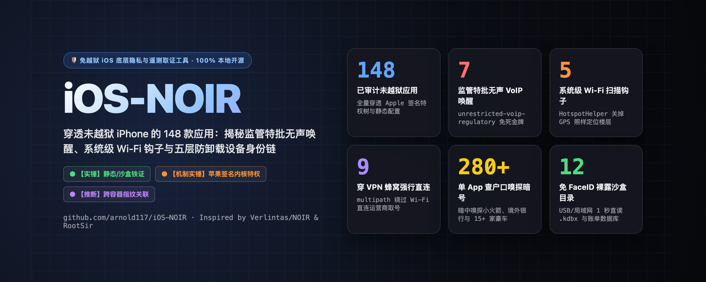

<p align="center">
  
</p>

# iOS-NOIR

**[English](README.md) · 简体中文**

[](LICENSE)
[-blue.svg)](#)
[](#)

**把「这台未越狱的 iPhone 到底在暗中泄露什么」变成一份带三级证据标注的可复现底层取证报告。**

📊 **完整交互式 HTML 报告样本（6 大标签页，支持深浅色模式）：** [`report/ios-noir-sample-report.html`](report/ios-noir-sample-report.html) *（下载后用任意浏览器直接打开）*

> 💡 **致敬 / Inspired by**  
> - **工具架构与本地优先理念**：受 [**Verlintas/NOIR**](https://github.com/Verlintas/NOIR)（基于 `adb` 的 Android 本地隐私审计工具）启发。  
> - **三级证据分级体系、五层持久设备身份链与独立交互式 HTML 报告**：深度借鉴 [**RootSir/claude-ios-privacy-analysis**](https://github.com/RootSir/claude-ios-privacy-analysis) 的严谨取证标准与可视化报告范式。

---

## ⚖️ 三级证据分级体系（杜绝夸大，严谨取证）

参考 [`RootSir/claude-ios-privacy-analysis`](https://github.com/RootSir/claude-ios-privacy-analysis) 的证据审计规范，**iOS-NOIR** 在终端与独立 HTML 报告中对每一项发现实施严格的三级证据标注：

- 🟢 **`【实锤 / VERIFIED】`**：直接从苹果官方签名的二进制 `Entitlements`、`Info.plist` 静态白名单（`LSApplicationQueriesSchemes`、`NSExceptionDomains`）、`ubiquity-kvstore` 或 `HouseArrest` 沙盒文件系统中实测提取到的确凿配置与裸露文件。
- 🟠 **`【机制实锤 / CAPABILITY】`**：应用持有苹果签发的特殊内核级豁免特权（如 `unrestricted-voip-regulatory`、`HotspotHelper`、`multipath`、`network-authentication`），底层逃逸通道已就绪（具体触发频率取决于服务端推送与运行时状态）。
- 🟣 **`【推断 / INFERRED】`**：基于多应用共享 `App Group` 容器、共享 `Keychain` 前缀及硬编码第三方风控/归因域名（如数字联盟 `shuzilm.cn`、联通 `id6.me`、秒针 `miaozhen.com`）的标准 SDK 行为推断其跨应用关联逻辑。

---

## 🧬 核心发现：五层持久设备身份链与 10 类隐秘后门

为什么在 iOS 上「关闭允许 App 请求跟踪 (IDFA) + 全程挂 VPN + 卸载重装 App」依然挡不住国内大厂与风控 SDK 精准锁定你的物理设备？**iOS-NOIR** 自动测绘整机 **五层持久设备身份链**：

1. **第 1 层：卸载重装、换新机都洗不掉的「iCloud 云端烙印」（`ubiquity-kvstore-identifier`）** `【实锤】`  
   将唯一设备追踪码写入你的私人 iCloud 隐藏键值对空间；卸载重装乃至买新 iPhone 登录同一 Apple ID 后自动秒级恢复。
2. **第 2 层：防卸载的「同厂商钥匙串持久化」（`keychain-access-groups`）** `【实锤】`  
   iOS 钥匙串数据在卸载 App 后永久保留在系统库中，且同一开发者前缀下的矩阵应用可直接跨 App 读取。
3. **第 3 层：跨应用沙盒串通池（`com.apple.security.application-groups`）** `【实锤】`  
   只要同系矩阵（如阿里系、腾讯系、字节系、Google 系、Meta 系）中有**任意 1 款**应用留在手机上，共享容器 `group.*` 内的设备 DNA 指纹就永不消失。
4. **第 4 层：绕过 Wi-Fi 与 VPN 直连三大运营商基站取号（`multipath` & `network-authentication`）** `【机制实锤】`  
   哪怕连着 Wi-Fi 或挂着 VPN，拥有多路径特权的应用也能强行拉起 `pdp_ip0` 蜂窝数据网卡，直连移动（`cmpassport.com`）、联通（`wostore.cn` / `id6.me`）、电信（`189.cn`）网关静默提取本机号码或暴露 SIM 卡归属地。
5. **第 5 层：无视 GPS 开关的「系统级 Wi-Fi 扫描钩子」（`HotspotHelper` & `multicast`）** `【机制实锤】`  
   揪出伪装成外卖/点评/支付软件（如美团、大众点评、支付宝、微信、钉钉）却持有 `HotspotHelper` 的应用——只要系统扫描 Wi-Fi，iOS 内核就会在后台自动唤醒它们并喂入周边路由器硬件 MAC 地址（BSSID）。

### 🚨 其他高危后门检出项
- **监管特批：无限制静默 VoIP 后台唤醒（`unrestricted-voip-regulatory`）** `【机制实锤】`：揪出持有苹果未公开监管豁免签名的超级 App（微信、QQ、钉钉），允许服务器下发无声 PushKit 指令把后台死进程静默拉活上万次，**屏幕不亮、不响、不留痕迹**。
- **“查户口式”已安装应用嗅探（`LSApplicationQueriesSchemes`）** `【实锤】`：揭穿单个查航班或社交软件内置多达 **280 个** URL Scheme 白名单，挨个嗅探你装没装小火箭 (`shadowrocket`)、海外银行、冷钱包或 15+ 家豪车 App。
- **无需 FaceID！USB / Wi-Fi 1 秒掏空沙盒文件漏洞（`UIFileSharingEnabled` / `HouseArrest`）** `【实锤】`：实测扫描哪些 App 将 `/Documents` 裸露在 USB 与局域网 Wi-Fi 同步接口下——无需解锁 App 即可直接枚举暴露的 `.kdbx` 密码库、银行对账单 PDF 及 `Sentiance` AI 行程追踪数据库。
- **ATS 加密降级与隐秘端点抽取（`NSExceptionDomains`）** `【实锤】`：静态抽取点名降级 HTTPS 的后门域名（当场抓获残留的 `jspatch.com` 远程热更新代码执行后门、`shuzilm.cn` 数字联盟指纹，以及视频会议软件内嵌的 12 家商业广告监测网）。

---

## 🚀 快速开始

> ⚠️ **平台兼容性说明**：目前仅在 **macOS** 下完成实机测试（macOS 原生自带苹果 `usbmuxd` 通信守护进程）。**Windows 与 Linux 暂未测试**（可能需要额外部署 iTunes 驱动或 `usbmuxd` 服务）。

### 1. 安装依赖
```bash
git clone https://github.com/arnold117/iOS-NOIR.git
cd iOS-NOIR
python3 -m venv .venv
source .venv/bin/activate
pip install -r requirements.txt
```

### 2. 连接 iPhone
用 USB 数据线连接 iPhone，解锁手机屏幕并在弹窗中点击 **「信任此电脑」**。

### 3. 一键全量扫描（自动生成终端仪表盘 + 独立 6 标签页 HTML 报告）
```bash
# 运行完整审计（输出至 noir-out/）
python ios_noir.py scan

# 英文终端输出 + 脱敏截图模式（方便发英文推文 / Hacker News）
python ios_noir.py scan --lang en --redact

# 在浏览器中打开交互式 HTML 报告（网页右上角自带「🇨🇳 简体中文 / 🇺🇸 English」一键切换按钮）
open noir-out/ios-noir-report.html
```

### 4. 启动实时“抓现行”隐私雷达
```bash
# 开启 30 秒实时监控，在手机上点开任意待测 App，毫秒级打印其调用的相机、麦克风、通讯录、定位与 IDFA 请求
python ios_noir.py radar --duration 30
```

---

## 🛡️ 内置反制护盾（`shields/`）

1. **免 VPN 系统级原生加密 DNS 护盾（[`shields/iOS-NOIR-System-Shield.mobileconfig`](shields/iOS-NOIR-System-Shield.mobileconfig)）**  
   基于苹果原生 `com.apple.dnsSettings.managed` 内核配置。通过隔空投送（AirDrop）发到手机安装后，**无需开启 VPN、零后台进程、零额外耗电**，由 iOS 内核网络栈 24 小时加密 DNS 查询并黑洞拦截主流追踪器域名；开启 Shadowrocket / Clash 时自动无缝让位，关闭 VPN 后 0 秒自动接管。
2. **分流拦截规则集（[`shields/ios_noir_shield.conf`](shields/ios_noir_shield.conf)）**  
   兼容 **Shadowrocket / Surge / Loon / Clash**，精准 `REJECT` 三大运营商免密取号网关（`cmpassport.com` / `wostore.cn` / `id6.me`）、数字联盟跨应用设备 DNA 指纹（`shuzilm.cn`）、`jspatch.com` 热更新后门、`online-metrix.net` 行为生物特征探针及主流广告遥测端点。

---

## 🔬 方法论与局限性声明（必读）

1. **未越狱 FairPlay DRM 边界**：未越狱 iPhone 上的 App Store 二进制受苹果 FairPlay 硬件加密保护，`iOS-NOIR` 专注于整机跨应用签名特权、沙盒容器与内核遥测审计，不对加壳二进制做反编译。如需对单款已脱壳 IPA 进行 Ghidra 68 万函数级反编译与字符串引用追踪，推荐结合 [**RootSir/claude-ios-privacy-analysis**](https://github.com/RootSir/claude-ios-privacy-analysis) 的工具链使用。
2. **特权就绪 `【机制实锤】` ≠ 全天候触发 `【实锤】`**：持有 `unrestricted-voip-regulatory` 或 `HotspotHelper` 证明苹果官方为其签发了突破沙盒常规限制的内核通行证，但具体唤醒与采集频率取决于服务端策略。
3. **静态豁免域 ≠ 实时流量**：`NSExceptionDomains` 中的域名为开发者在 `Info.plist` 中显式声明的白名单，部分可能属于历史遗留配置或按条件触发的备用通道。

---

## 📜 致谢与开源许可

- **灵感来源**：[Verlintas/NOIR](https://github.com/Verlintas/NOIR) & [RootSir/claude-ios-privacy-analysis](https://github.com/RootSir/claude-ios-privacy-analysis)
- **底层通信支持**：[doronz88/pymobiledevice3](https://github.com/doronz88/pymobiledevice3) & [Textualize/rich](https://github.com/Textualize/rich)
- **作者**：Arnold · PGP 指纹：`C3D9 CA55 2798 2586 BB20  F2DB 7B25 BE32 527E FEA1`
- **许可证**：[MIT](LICENSE)
